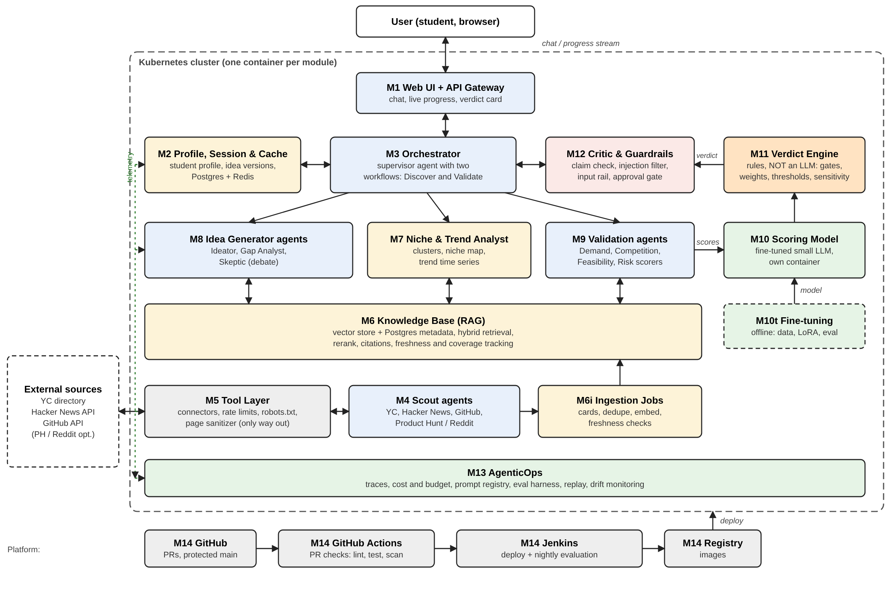

# Idea Generator with Go / No-Go
CS4032 Software Construction and Development, FAST-NUCES. Semester project (group of 2).

An interactive multi-agent system that helps a student choose a project. It collects startup ideas and products from
public sources (Hacker News, GitHub, Reddit / Product Hunt), organises them into a map of niches and trends, and works in two modes:
- **Discover**: give your profile, get ideas that fit, including new ideas built from gaps in the data.
- **Validate**: bring an idea and get **GO / PIVOT / NO-GO / INSUFFICIENT EVIDENCE** with evidence, what would change it, and how stable it is.

> The language model never decides the verdict. Models produce evidence-backed scores; a deterministic, unit-tested
> engine (M11) turns them into the verdict. Decision support, not a prediction of success.



## This repository currently contains the **build harness**
Everything a coding agent (Claude Code, Codex) or a human needs to build the system autonomously:
| Start here | |
|---|---|
| `CLAUDE.md` / `AGENTS.md` | Operating manual for coding agents: rules, loop, stack, commands |
| `PROGRESS.md` | Live project state, gate log, blockers |
| `docs/harness/00_INDEX.md` | Map of all specs: PRD, requirements, architecture, data model, API, flows, state machines, verdict engine, agents, RAG, fine-tuning, AgenticOps, security, testing, CI/CD, Kubernetes, plan, critical path, gates, backlog, UI, deliverables, risks, don'ts, traceability, assumptions, glossary, tech stack |
| `docs/source/` | The instructor's two PDFs (`Project.pdf` = what to build, `Project_Guide.pdf` = how to build it) |
| `config/`, `rubrics/`, `schemas/`, `prompts/`, `eval/` | Seed artefacts (rules, rubrics, JSON contracts, prompts, eval sets, verdict test vectors) |

### How to use the harness with a coding agent
1. Clone `https://github.com/IfBilal/idea-validator`. `main` is protected: work on a branch and open a PR (see `docs/harness/15_CICD.md`).
2. Fill team info + get API keys (see `PROGRESS.md` → Blocked / Needs human). Put keys in a local `.env` (never commit).
3. Open the repo in Claude Code (or Codex) and say: **"Read CLAUDE.md and PROGRESS.md, then run /next-task."**
   Each developer tells their agent which role they are (Dev A = Taimoor or Dev B = Bilal, see `18_CRITICAL_PATH_AND_PARALLELIZATION.md`).
4. After each phase: **`/phase-gate <N>`** (testing + security gate). Capture the phase's screenshots.
5. Review every PR yourselves (the other member approves). Keep `docs/ai-usage-log.md` current.

## Prerequisites
| Tool | Version | Used for |
|---|---|---|
| Python + [uv](https://docs.astral.sh/uv/) | 3.12 | services, libs, tests (`make setup`) |
| Node.js + npm | 20 LTS or newer | React UI (Phase 1+) |
| Docker | recent | images, `docker compose` for dev databases |
| kind, kubectl, kustomize | pinned in Phase 1 | local Kubernetes cluster |
| git + GitHub CLI (`gh`) | recent | PR workflow |
| RAM | ≥ 16 GB | cluster + Jenkins + databases + model server |

Keys (LLM provider, GitHub, Reddit / Product Hunt) go in a local `.env` copied from `.env.example`. Never commit it.

## Quick start (fill in as the system is built; must stay ≤ ~10 commands)
```bash
cp .env.example .env            # add LLM_API_KEY / GROQ_API_KEY locally (never committed)
make setup                      # uv + npm deps, pre-commit
make k8s-up                     # kind + Calico + registry + ingress + metrics-server
make images TAG=dev             # build and push the 13 images to localhost:5001
make deploy TAG=dev             # secrets from .env, manifests, datastores, migrate Job, all Deployments
make smoke                      # register, login, save a profile, read it back, through the Ingress
make netpol-test                # only the tool layer reaches the internet; closed edges stay closed
make seed                       # restore card snapshot (needs the ingestion job, issue #30)
```

### Dev databases without Kubernetes (docker compose)
Postgres, Redis and Qdrant for running services or tests on the host:
```bash
make up        # creates missing POSTGRES_* / DATABASE_URL / REDIS_URL in .env, starts the stack, waits until healthy
make migrate   # Alembic migrations on that Postgres
make down      # stop it (volumes are kept; `docker compose down -v` deletes the data)
```
If a host port is taken, set `POSTGRES_PORT`, `REDIS_PORT` or `QDRANT_PORT` in `.env`. Tests use testcontainers (Docker) or
`TEST_DATABASE_URL` / `TEST_REDIS_URL`, so they do not need this stack. Cluster scripts pin their own kubeconfig
(`~/.kube/idea-validator.kubeconfig`) and refuse any other context.

## Team
| Member | Roll no. | Role |
|---|---|---|
| Taimoor (`T361`) | 24i-3015 | Dev A: Platform, Data, Ops & UI |
| Bilal (`IfBilal`) | 24i-3166 | Dev B: Decision, Agents & Analysis |
