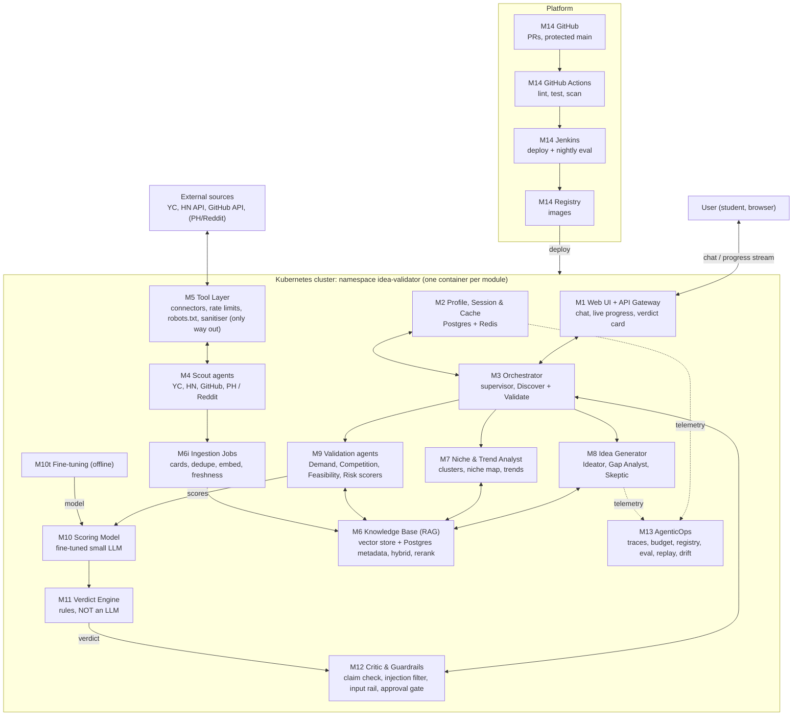

# 03 — Architecture

Reference figure: `figure1_architecture_from_pdf.png` (Description Figure 1). Solid arrows = requests and data.
Green dotted arrows = telemetry sent to M13. Scouts reach the internet only through M5. Each module = its own container.

## 1. Architecture as drawn by the instructor (exact edges)



### How we implement the drawn edges (call direction in code)
The figure shows **data flow**. In code M3 is the supervisor and is the caller for most steps:

| Edge in figure | Implemented as |
|---|---|
| User ↔ M1 | HTTPS through Ingress; REST + SSE (`/runs/{id}/events`) |
| M1 ↔ M3 | M1 → `M3 POST /runs` (start), `GET /runs/{id}`, `POST /runs/{id}/answer|approve`; M3 publishes events to Redis pub/sub channel `run:{id}` which M1 relays as SSE |
| M2 ↔ M3 | M3 reads profiles/ideas/versions and writes runs/verdicts via M2's internal API (`/internal/*`); M2 owns Postgres + Redis (only M2 talks to Postgres app tables) |
| M3 → M7, M8, M9 | HTTP POST to each agent service |
| M7/M8/M9 ↔ M6 | `M6 POST /search`, `GET /cards/{id}`, `GET /evidence/{id}` |
| M9 → M10 (scores) | `M10 POST /score` (rubric, idea, evidence, features) |
| M10 → M11 | Scores flow to M11. **M3 collects the M9/M10 scores and calls `M11 POST /verdict`** (keeps M11 pure and stateless) |
| M11 → M12 (verdict) | M3 passes M11's verdict + claims to `M12 POST /check` before the card is shown; M12 never changes the verdict, only flags/removes unsupported claims and then M3 asks M11 to recompute |
| M3 ↔ M12 | input rail (`/rail/input`), objection check (`/check`), approval decision (`/approval/evaluate`) |
| M4 ↔ M5 | scouts call `M5 POST /fetch` only |
| M4 → M6i → M6 | scouts write raw pages to the raw store (`raw_pages` table / PVC); ingestion job converts to cards and upserts into M6 |
| Ext ↔ M5 | only M5 has egress (NetworkPolicy) |
| any → M13 | every service posts trace records to `M13 POST /trace` (async, fire-and-forget with local buffer) and logs JSON to stdout |
| Hosted LLM | **every** hosted-model call (agents, M10 fallback, label drafting inside cluster) goes through `M5 POST /llm`, because only M5 may reach the internet |

## 2. Module catalogue

| Module | Service dir | K8s kind | Port | Image | Depends on | Called by |
|---|---|---|---|---|---|---|
| M1 UI | `services/ui` | Deployment | 8080 | `ui` | M1 API | browser via Ingress |
| M1 API Gateway | `services/gateway` | Deployment + HPA | 8000 | `gateway` | M2, M3, Redis (rate limit + pubsub) | UI, browser |
| M2 Profile/Session/Cache | `services/profile` | Deployment | 8000 | `profile` | Postgres, Redis | M1, M3 |
| M3 Orchestrator | `services/orchestrator` | Deployment | 8000 | `orchestrator` | M2, M6, M7, M8, M9, M11, M12, M13, Redis | M1 |
| M4 Scouts | `services/scouts` | CronJobs (+ Deployment for on-demand `POST /scout`) | 8000 | `scouts` | M5, raw store | CronJob, M3 (on-demand scout) |
| M5 Tool Layer | `services/tools` | Deployment | 8000 | `tools` | Internet, Redis (cache/rate-limit) | M4, M10, M8/M9 (LLM), M3 |
| M6 KB | `services/kb` | Deployment | 8000 | `kb` | Qdrant, Postgres (KB schema) | M3, M7, M8, M9, M12 |
| M6i Ingestion | `jobs/ingestion` | CronJob | — | `ingestion` | raw store, Postgres, Qdrant | CronJob |
| M7 Analyst | `services/analyst` | Deployment (+ CronJob recompute) | 8000 | `analyst` | M6 | M3, M8, M9 |
| M8 Ideation | `services/ideation` | Deployment ("agents") | 8000 | `ideation` | M6, M7, M5 (/llm), M12 | M3 |
| M9 Validators | `services/validators` | Deployment ("agents") | 8000 | `validators` | M6, M7, M10 | M3 |
| M10 Scorer | `services/scorer` | Deployment (`model-server`) | 8000 | `scorer` | model file (PVC / init download via Job), M5 (/llm fallback) | M9 |
| M10t Fine-tune | `jobs/finetune` | offline (Colab/Kaggle) + import Job | — | — | — | humans |
| M11 Verdict | `services/verdict` | Deployment (2 replicas) | 8000 | `verdict` | ConfigMap only | M3 |
| M12 Critic | `services/critic` | Deployment | 8000 | `critic` | M6, M5 (/llm) | M3 |
| M13 AgenticOps | `services/agentops` | Deployment + Jobs (eval, drift) | 8000 | `agentops` | Postgres (traces_index), PVC (traces) | all |
| Postgres | — | StatefulSet + PVC | 5432 | `postgres:16.4-alpine` | — | M2, M6, M6i, M13 |
| Redis | — | StatefulSet/Deployment | 6379 | `redis:7.4-alpine` | — | M1, M2, M3, M5 |
| Qdrant | — | StatefulSet + PVC | 6333 | `qdrant/qdrant:v1.12.x` | — | M6, M6i |

That is **13+ distinct images** (requirement: ≥ 6). M2 is its own service so the "layered backend (routes, services,
repositories)" requirement is visible in one place. (Option allowed by Guide 9.1: M8 + M9 in one "agents" Deployment.
We keep them separate; merging is a fallback if the laptop runs out of RAM; record an ADR if you do.)

## 3. Internal service skeleton (every Python service)

```
services/<name>/
  Dockerfile              # multi-stage, non-root, pinned (Guide §4.4 pattern)
  .dockerignore
  pyproject.toml          # pinned deps (or requirements.txt + requirements.lock)
  src/
    main.py               # FastAPI app factory, /health, /ready, /metrics, middleware (request id, tracing, JSON logs)
    config.py             # pydantic-settings; all settings from env/ConfigMap; no defaults pointing to localhost in prod
    api/routes.py         # HTTP layer only: parse, validate, call service, map errors
    services/             # business logic (pure where possible)
    repositories/         # DB/Redis/HTTP-client access only
    clients/              # typed clients for other modules (generated from schemas), retries + timeouts
    models/               # Pydantic models (import from libs/common/schemas where shared)
  tests/
    unit/  component/  contract/  fixtures/recorded/
```

Layering rule (M2-06, applies everywhere): `api → services → repositories/clients`. Routes never touch the DB.
Services never import FastAPI. Repositories contain no business rules.

## 4. Shared library `libs/common`
- `schemas/`: Pydantic models mirroring `schemas/*.schema.json` (IdeaCard, Profile, EvidenceItem, DimensionScore,
  Verdict, TraceRecord, RunEvent, Claim, CheckResult, FetchRequest/Response, LLMRequest/Response, ScoreRequest).
  A CI test asserts Pydantic `model_json_schema()` matches the committed JSON Schema (no drift).
- `tracing.py`: `Tracer(run_id)` context, `span(agent, kind, tool)` context manager → posts TraceRecord to M13 and
  prints it as a JSON line; carries `run_id`, `parent_step` via headers `X-Run-Id`, `X-Parent-Step`.
- `http.py`: `ServiceClient` wrapping httpx with timeout, tenacity retry (2, exp back-off + jitter, only on
  timeouts/5xx/429), propagation of trace headers, budget headers.
- `config.py`: loads YAML ConfigMaps mounted at `/etc/idea-validator/*.yaml` + env overrides.
- `logging.py`: structlog JSON to stdout; redacts keys matching `*key*|*token*|*password*|authorization`.
- `budget.py`: `BudgetLedger` (tokens, pages, steps, cost) backed by Redis hash `budget:{run_id}`.

## 5. Runtime communication rules
- Synchronous REST (JSON) inside the cluster; DNS names `http://<service>.idea-validator.svc.cluster.local:8000`
  injected via env (`M6_URL`, …); **never hard-code hosts**.
- Async progress: M3 → Redis pub/sub `run:{run_id}` → M1 SSE. Events also persisted (trace) so a reconnecting
  client replays from `Last-Event-ID`.
- All requests carry `X-Request-Id`, `X-Run-Id`, `X-Parent-Step`; internal calls also carry `X-Internal-Token`
  (shared secret from K8s Secret) so only cluster services call internal endpoints (defence in depth on top of NetworkPolicy).
- Timeouts: tool fetch 10 s, KB search 5 s, scorer 60 s, LLM 60 s, verdict 2 s. Retries ≤ 2.

## 6. Deployment topology (Guide Figure 3)
Namespace `idea-validator`:
- **Ingress** (single entry point) → `ui` (/) and `gateway` (/api).
- **Deployments (stateless)**: ui, gateway (HPA), profile, orchestrator, ideation, validators, verdict, critic,
  tools, kb, analyst, scorer (model-server), agentops.
- **StatefulSets / PVCs**: postgres (PVC), qdrant vector-store (PVC), redis.
- **Jobs**: evaluation job, fine-tuned model import job (downloads GGUF from release asset into model PVC).
- **CronJobs**: scouts (per source, hourly/6-hourly/daily), ingestion + freshness check, drift report.
- **ConfigMaps**: weights, thresholds, floors, rubric versions, budgets, sources/allow-list.
- **Secrets**: API keys, DB password, JWT secret, internal token.
- **NetworkPolicy**: default deny (ingress + egress); allow DNS; allow intra-namespace service traffic per edge
  table; ui reaches gateway only; **only tool-layer has internet egress**.
- **Every workload**: liveness + readiness probes, requests and limits (from measurements), non-root, pinned image.
- **Observability**: traces to stdout (JSON lines) + trace volume; `/metrics`; dashboard; cost per verdict.
- **Rollout**: RollingUpdate, maxUnavailable 0, `kubectl rollout undo` demonstrated.

## 7. Key architectural decisions (ADRs in `docs/decisions/`)
- ADR-001 Verdict computed by deterministic code (M11), never by a model.
- ADR-002 Hybrid search (BM25/Postgres FTS + Qdrant vectors) with cross-encoder reranking.
- ADR-003 Hosted LLM calls are proxied through M5 so the NetworkPolicy "only M5 reaches the internet" holds.
- ADR-004 Learning & portfolio value is scored by the Feasibility-for-this-student scorer (M9 has 4 scorers, 6 dimensions).
- ADR-005 kind + Calico + local registry as the cluster (NetworkPolicy enforcement).
- ADR-006 Score = blend of computed-feature prior and model judgment (α configurable).
