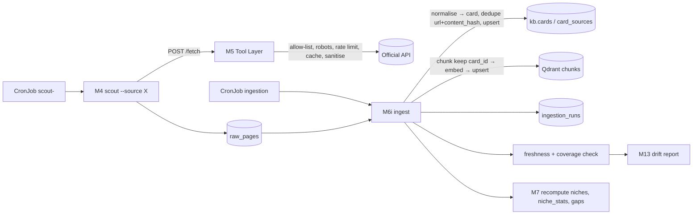

# 06 — Data Flows (sequence diagrams)

Reference figures: `figure2_3_workflows_from_pdf.png` (Discover, Validate). Each step lists the modules the
instructor assigned to it. Keep those assignments exactly.

## 1. Discover (Description Figure 2)

| Step | Name | Modules | What happens |
|---|---|---|---|
| 1 | Request | M1, M2 | Student sends profile + niche wish. M1 validates input; M2 loads current profile (+version). |
| 2 | Niches | M7 + M6 | Pick niches and trends that fit the profile (rising niches preferred; saturated penalised). |
| 3 | Ideator | M8 | Proposes ideas **citing gap evidence**. |
| 4 | Gap Analyst | M8 + M6 | Adds complaints and missing features (from KB). Idea list goes on to step 5. |
| 5 | Skeptic | M8 | Argues against each idea with evidence. |
| 6 | Critic | M12 | Keeps only objections backed by evidence. Ideas defeated with evidence are **dropped**. |
| loop | Debate | M3 | Steps 3–6 repeat **up to 3 rounds**. |
| 7 | Validate | M9 to M11 | Survivors go through the full Validate workflow. |
| 8 | Result | M1, M13 | Ranked ideas with verdict cards; trace and cost recorded. |

```mermaid
sequenceDiagram
  autonumber
  participant U as Browser
  participant G as M1 Gateway
  participant P as M2 Profile
  participant O as M3 Orchestrator
  participant A as M7 Analyst
  participant KB as M6 KB
  participant I as M8 Ideation
  participant C as M12 Critic
  participant V as Validate sub-workflow (M9,M10,M11,M12)
  participant T as M13 AgenticOps
  U->>G: POST /discover {niche, count}
  G->>C: rail/input (niche text)
  G->>O: POST /runs {kind: discover}
  O-->>G: run_id
  G-->>U: 202 run_id ; U opens SSE /runs/{id}/events
  O->>P: get profile (+version)
  O->>A: POST /niches/match {profile, niche_wish}
  A->>KB: search/stats
  O->>A: GET /gaps?niche=...
  loop round = 1..3 (stop early if no new objections accepted)
    O->>I: POST /ideate {profile, niches, gaps, previous_objections}
    I->>KB: search (gap evidence)
    O->>I: POST /gap-analyst {ideas}
    I->>KB: search complaints / missing features
    O->>I: POST /skeptic {ideas}
    O->>C: POST /objections/filter → /check claims
    C-->>O: accepted objections (evidence-backed)
    O->>O: drop ideas defeated with evidence; record idea_dropped events
  end
  par for each surviving idea (max N concurrently)
    O->>V: Validate(idea, profile)
  end
  O->>P: save ideas (source=generated), versions, verdicts
  O-->>G: events (partial_result, verdict, run_completed)
  O->>T: traces (every step)
```

"Defeated with evidence" rule: an idea is dropped if the Critic accepts ≥1 objection that is **fatal**
(dimension in {feasibility, risk} with claim of a blocker, or competition/duplicate with a named KB product having
the same core features for the same user) OR ≥2 accepted objections on different dimensions. Non-fatal accepted
objections are passed to the Ideator for the next round as `previous_objections` (the idea may be revised).

## 2. Validate (Description Figure 3)

| Step | Name | Modules | What happens |
|---|---|---|---|
| 1 | Intake | M1, M3 | Idea + profile; clarify if needed (only questions that change the result). |
| 2 | Evidence | M6, M4, M5 | Retrieve cards; **scout on demand** (through M5) when evidence is thin; approval if expensive. |
| 3 | Scorers | M9 + M10 | 4 scorers run in parallel, each with its own rubric. |
| 4 | Features | M6, M7 | Computed numbers from the evidence (n_sources, n_platforms, trend_growth, …). |
| 5 | Verdict | M11 | Gates, weights, thresholds, confidence. |
| 6 | Challenge | M8, M12 | Skeptic objects; critic checks claims; accepted objections adjust scores. |
| 7 | Stability | M11 | Sensitivity check and what-would-make-GO. |
| 8 | Card | M1, M13 | Verdict card; trace and cost recorded. |

Note on order: the figure lists Scorers (3) before Features (4) but scorers *consume* features. Implementation:
features are computed in step 4 **and passed into the scorers**, i.e. M3 runs step 4's feature computation as soon
as evidence is ready, then fans out to the scorers. Both are recorded under their step names in the trace so the
trace still shows the instructor's 8 steps. (See `27_ASSUMPTIONS…` A-07.)

```mermaid
sequenceDiagram
  autonumber
  participant U as Browser
  participant G as M1
  participant O as M3
  participant P as M2
  participant C as M12
  participant KB as M6
  participant S as M4 Scouts
  participant TL as M5 Tools
  participant A as M7
  participant V as M9 Validators
  participant M as M10 Scorer
  participant E as M11 Verdict
  participant I as M8 Skeptic
  participant T as M13
  U->>G: POST /validate {idea_text}
  G->>C: rail/input
  G->>O: POST /runs {kind: validate}
  O->>P: profile + create idea/version
  O->>P: cache lookup verdict:{...versions...}
  alt cache hit
    P-->>O: verdict (cache_hit=true) → card (skip to step 8)
  end
  Note over O: Step 1 Intake: find unknowns (effort, target user, data needs)
  O->>E: /value-of-information per unknown
  opt verdict changes across plausible range
    O-->>U: event question ; wait POST /runs/{id}/answer
  end
  Note over O: Step 2 Evidence
  O->>KB: POST /search (several queries: problem, competitors, complaints)
  opt evidence thin (n_sources<3 or n_platforms<2)
    O->>C: approval/evaluate (estimated cost of deep search)
    opt needs approval
      O-->>U: approval_required ; wait /approve
    end
    O->>S: POST /scout (on demand)
    S->>TL: POST /fetch (allow-list, robots, rate limit, cache, sanitiser)
    S->>KB: (via ingestion of raw pages) new cards
    O->>KB: search again
  end
  Note over O: Step 4 Features
  O->>A: POST /features {idea, evidence_ids, profile}
  Note over O: Step 3 Scorers (parallel)
  O->>V: POST /score-all
  par demand_pain
    V->>M: /score (demand_pain rubric)
  and competition + differentiation
    V->>M: /score x2
  and feasibility + learning
    V->>M: /score x2
  and risk
    V->>M: /score
  end
  V-->>O: 6 DimensionScores (or abstentions) + gate inputs
  Note over O: Step 5 Verdict
  O->>E: POST /verdict
  Note over O: Step 6 Challenge
  O->>I: POST /skeptic {idea, scores}
  O->>C: POST /check (objections + all score claims)
  C-->>O: accepted objections ; unsupported claims removed
  Note over O: Step 7 Stability
  O->>E: POST /verdict (with objections_accepted) → final verdict incl. sensitivity
  O->>E: POST /whatif → candidates
  O->>I: POST /suggest-changes (turn dimension deltas into concrete change texts)
  Note over O: Step 8 Card
  O->>P: save verdict + dimension_scores + cache
  O-->>G: verdict event → card
  O->>T: traces + cost (traces_index)
```

## 3. What-if (U7)
1. User clicks "What would make this GO?" → candidates already in the card (from step 7).
2. User clicks "Apply" on change `c2` → `POST /ideas/{id}/whatif {version, change_id}`.
3. M3: new `idea_version = v+1` with `text = M8 rewrite(idea, change)` and `change_note`.
4. M3 re-runs **only what changed** (memoised): retrieval for the new text (cache), features, scorers (all four
   because text changed; for a profile-only change only feasibility/learning), M11, challenge, stability.
5. Card v2 shown with diff vs v1 (dimension deltas, verdict change). Verdict computed by the engine, never by the model.

## 4. Challenge (U8)
1. User presses "Challenge" on claim `cl_7` of version v.
2. `M12 /check` re-checks `cl_7` against its evidence ids (existence in M6 + support check).
3. Supported → `defended` with supporting quote and link; nothing changes.
4. Not supported → claim removed; its evidence ids removed from the dimension score; if no evidence left that
   scorer's dimension is marked abstained; M11 recomputes → new version v+1 (`change_note: "challenge removed cl_7"`);
   card shows the outcome and the new verdict.

## 5. Approval (U4)
```
estimate = cost_model(action)          # e.g. deep search: pages × avg_tokens × price + scorer calls
if budget.spent + estimate > budget.limit:
    create approvals row (pending); emit approval_required; state = AWAITING_APPROVAL
    wait (timeout 10 min → expired = declined)
    approve → raise run budget by estimate (one-time), proceed ; decline → skip step, continue with what we have
```

## 6. Scouting & ingestion (scheduled)


## 7. Telemetry
Every service: `span()` → TraceRecord → stdout JSON line + async `POST M13 /trace`. M13 appends to
`traces/<run_id>.jsonl`, updates `traces_index`, exports metrics. Run-level spend is mirrored to Redis
`budget:{run_id}` by M3/M5 for enforcement.
