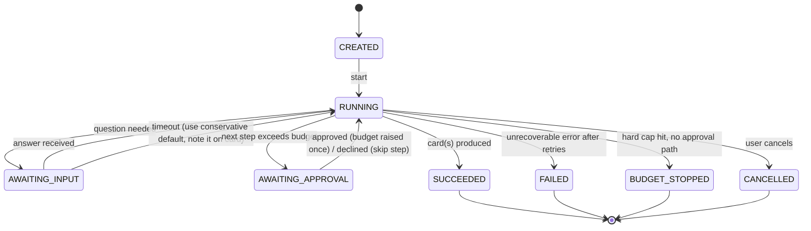
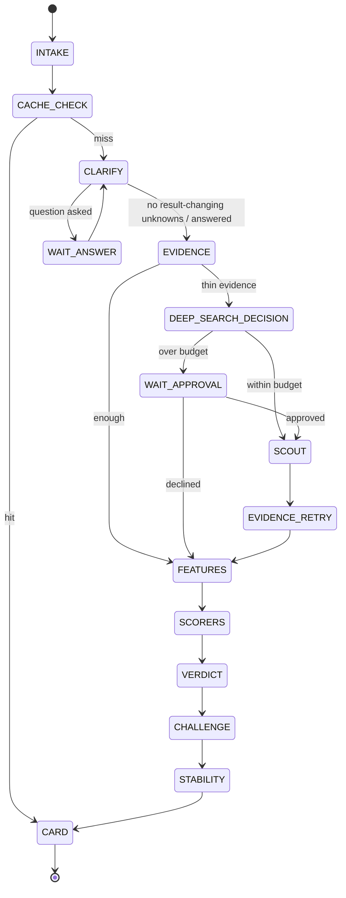
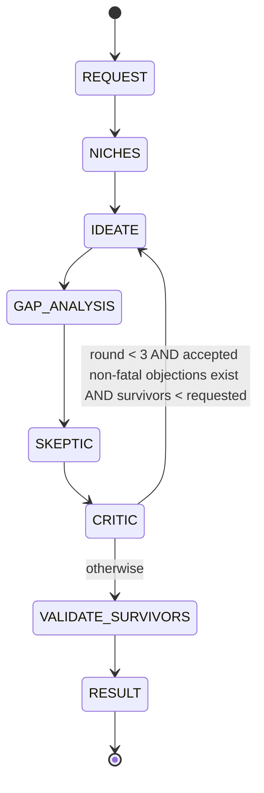

# 07 — Orchestrator (M3) Workflows as Testable State Machines

M3 is a **supervisor** that runs Discover and Validate as explicit, testable state machines (M3-01).
Implementation: **LangGraph** `StateGraph` (see `29_TECH_STACK.md`).
- `services/orchestrator/src/graphs/validate.py` and `discover.py` build the graphs; state = Pydantic models
  `ValidateState` / `DiscoverState`.
- **Nodes** (`src/nodes/*.py`) are plain async functions `async def node(state, deps) -> dict` (partial update).
  `deps` holds typed HTTP clients injected at build time → in tests they are fakes / recorded responses.
- **Routing** functions (`src/routing.py`) are **pure** `(state) -> next_node_name` → table-driven unit tests.
- **Human-in-the-loop**: `interrupt({"type":"question"|"approval", ...})` inside CLARIFY / DEEP_SEARCH_DECISION;
  M1's `/answer` and `/approve` call M3, which resumes the thread with `Command(resume=value)`.
- **Checkpointer**: `AsyncPostgresSaver` (schema `orchestrator`), `thread_id = run_id` → crash-safe resume.
- **Parallel scorers**: the SCORERS node fans out with `asyncio.gather` over the 4 M9 scorer endpoints (or LangGraph
  parallel branches / `Send`), each with its own timeout; results reduced into `state.scores`.
- **Events**: a callback/handler publishes each node start/finish, tool call and spend update to Redis `run:{id}`.
- Fallback if LangGraph blocks progress: same nodes + routing functions driven by a 50-line asyncio loop (ADR required).

The diagrams below are the contract; whatever the engine, every state below is a named node and every arrow is a
tested routing decision.

## 1. Common run lifecycle

Run state persisted in `app.runs` after every transition (crash-safe). On restart M3 lists the non-terminal runs
(`GET /internal/runs?state=created,running,awaiting_input,awaiting_approval`), takes a per-run Redis lease
(single flight across replicas) and rehydrates each from its LangGraph checkpoint: a paused run gets its question or
approval back, a running run continues from its last checkpoint (bounded concurrency; a step that was in flight is
not charged twice; memoised steps cost nothing), a run with no readable checkpoint becomes FAILED with the fixed
reason "the run could not be recovered after a restart". Stored events (`run:{id}:events`) are replayed by
`GET /runs/{id}/events?after=` and the event sequence continues. Details: services/orchestrator/README.md.

## 2. Validate state machine

| State | Action | Output memo key | Timeout | Retries |
|---|---|---|---|---|
| INTAKE | rail/input, load profile, create idea_version | `intake:{idea_hash}` | 5 s | 1 |
| CACHE_CHECK | M2 verdict cache lookup (key with all versions) | — | 1 s | 0 |
| CLARIFY | identify unknowns; M11 value-of-information; ≤3 questions total | `clarify:{idea_hash}:{p_ver}` | 5 s | 1 |
| EVIDENCE | M6 search × (problem, competitors, complaints, demand) queries | `evidence:{idea_hash}:{index_ver}` | 5 s each | 2 |
| DEEP_SEARCH_DECISION | M12 approval/evaluate | — | 2 s | 1 |
| SCOUT | M4 `/scout` (via M5) for missing platforms | `scout:{query_hash}` | 60 s | 1 |
| FEATURES | M7 `/features` | `features:{idea_hash}:{evid_hash}:{p_ver}` | 10 s | 2 |
| SCORERS | M9 `/score-all` (4 scorers in parallel, each own timeout) | `score:{dim}:{inputs_hash}:{rubric_ver}` | 60 s per scorer | 2 (+M10 own retry/fallback) |
| VERDICT | M11 `/verdict` | `verdict0:{scores_hash}:{cfg_ver}` | 2 s | 2 |
| CHALLENGE | M8 `/skeptic` → M12 `/check` | `challenge:{scores_hash}` | 60 s | 1 |
| STABILITY | M11 `/verdict` with objections → sensitivity; `/whatif`; M8 `/suggest-changes` | `final:{...}` | 30 s | 2 |
| CARD | M12 claim check on card claims, persist (M2), cache, emit event | — | 5 s | 2 |

Failure policy: if a scorer fails after retries **and** fallback, that dimension **abstains** (never invented).
M11 then returns INSUFFICIENT_EVIDENCE naming the abstained dimension. If M6 is down → run FAILED with
clear error. If M11 is down → FAILED (never compute a verdict elsewhere).

## 3. Discover state machine

- `round` counter starts at 1; **hard max 3** (config `budgets.yaml: debate.max_rounds = 3`, cannot exceed 3).
- Ideator asked for `count + 3` ideas in round 1 (over-generate because some get dropped).
- VALIDATE_SURVIVORS runs the Validate machine as a **sub-machine** per idea, max 3 concurrently, sharing the
  run budget; each child has `parent_step` set for traces.
- RESULT ranks: verdict rank (GO 4, PIVOT 3, INSUFFICIENT_EVIDENCE 2, NO-GO 1), then score desc, then confidence desc.

## 4. Parallelism (M3-02)
- `asyncio.gather` with per-task timeout; `return_exceptions=True` so one failing scorer doesn't cancel others.
- Concurrency limits via `asyncio.Semaphore` from config (`scorers: 4`, `validate_children: 3`).

## 5. Retries and timeouts (M3-03)
- `libs/common/http.ServiceClient`: tenacity `stop_after_attempt(1+max_retries)`, `wait_exponential_jitter(0.5, 8)`,
  retry on `httpx.TimeoutException`, 429, 502, 503, 504. Never retry 4xx validation errors.
- Every retry increments `retries` in the trace record.

## 6. Budgets (M3-04, M13-03)
`config/budgets.yaml` per run kind: `max_tokens`, `max_pages`, `max_steps`, `max_cost_usd`, `approval_threshold_usd`.
Before every model/tool step: `ledger.would_exceed(estimate)` → if hard cap & approval possible → AWAITING_APPROVAL;
if approval impossible (e.g. steps cap) → BUDGET_STOPPED with partial results. M5 enforces pages/tokens independently
(defence in depth) and returns 402 BUDGET_EXCEEDED.

## 7. Re-run only what changed (M3-05)
Each step has a deterministic **input hash** (sha256 over canonical JSON of its inputs + relevant versions).
Outputs are memoised in `runs.context[step][input_hash]` and in Redis caches. On what-if/challenge/profile change
the machine recomputes hashes; unchanged steps are reused and traced with `cache_hit=true`.
Examples: profile hours change → only FEATURES (feasibility features), feasibility+learning scorers, VERDICT,
STABILITY re-run. Rubric version change → all scorers for that dimension re-run (cache key includes rubric version).

## 8. Every decision traced (M3-06)
Transitions emit `kind:"decision"` TraceRecords: `{agent:"orchestrator", tool:"transition", input:{from, event},
output:{to, reason}}`. Also: why a question was/wasn't asked, why an idea was dropped, why scouting was triggered,
approval outcome, cache hits.

## 9. Testing the machines
- Unit: table-driven tests of the transition function for every (state, event) pair incl. illegal ones.
- Behaviour: full runs with recorded responses (`tests/fixtures/recorded/*.json`): happy path GO, thin evidence →
  INSUFFICIENT_EVIDENCE, approval decline, scorer invalid JSON → fallback, tool timeout → retry then abstain,
  debate drops an idea, 3-round cap respected, budget stop.
