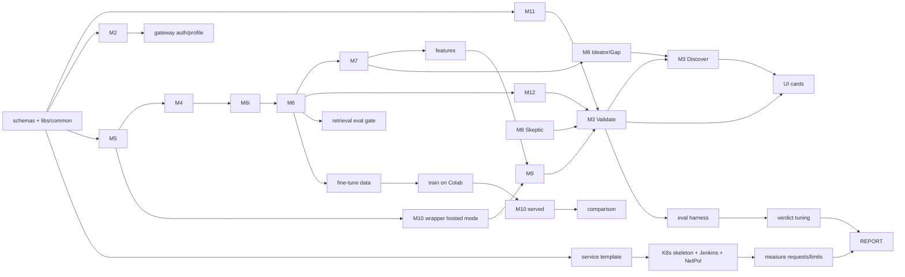

# 18 — Critical Path, Dependencies and Parallel Work

## 1. Ownership (both members still review each other's PRs and must explain everything)
| Dev A: Platform, Data & Ops | Dev B: Decision, Agents & UI |
|---|---|
| M14 Platform (repo, CI, Jenkins, Docker, K8s, NetworkPolicy) | M11 Verdict Engine |
| M5 Tool Layer (incl. LLM proxy) | M2 Profile, Session & Cache; M1 Gateway |
| M4 Scouts, M6i Ingestion, M6 KB, retrieval eval | M3 Orchestrator (LangGraph) |
| M7 Niche & Trend Analyst | M9 Validation agents (+ M10 wrapper contract) |
| M12 Critic & Guardrails; M8 Skeptic/Change Suggester | M8 Ideator + Gap Analyst; Discover |
| M10t Fine-tuning + M10 serving | M1 UI (most screens) |
| M13 traces, replay, drift, dashboard | M13 eval harness; verdict tuning |
Shared: labelled sets (retrieval queries, fine-tune hand checks, verdict labels), merge-conflict exercise, screenshots, report.

## 2. Module dependency graph


## 3. Critical path (longest chain, protect it)
```
schemas/libs (D1) → M5 tool layer (D2) → scouts (D2) → ingestion ≥1,500 cards (D3 AM) → M6 hybrid search (D3)
→ M7 features + gaps (D3 PM) → M9 scorers (D4 AM) → M3 Validate graph (D4) → M3 Discover (D5)
→ eval harness + labelled set (D5–D6) → verdict tuning before/after (D6) → screenshots (D6–D7) → report (D7)
```
Second chain (parallel, must not slip): `KB (D3) → fine-tune candidates (D3) → labels + hand-check (D3–D4) → Colab
training (D4, overnight) → M10 served + comparison (D5)`.

**Slack:** M11 (pure code) has lots of slack. Build it D2 so M3 never waits, then help on UI.
**Risks on the critical path:** API keys for Reddit/PH (request on D1!), scout rate limits (start scouting D2 morning and
let CronJobs run overnight), Colab GPU availability (have Kaggle as backup), laptop RAM (see 24).

## 4. What can run in parallel (and what must not)
| Can be parallel | Why it's safe |
|---|---|
| M11 (B) ‖ M5 + scouts (A) | M11 depends only on schemas |
| M2/gateway auth (B) ‖ ingestion (A) | Different tables/services; schemas fixed in P0 |
| UI shell & components with MSW mocks (B) ‖ backend agents | Contracts in 05 + schemas; MSW mocks from examples |
| Fine-tune data/training (A) ‖ M3 graphs (B) | M9 uses M10 wrapper contract in hosted mode until model is ready |
| M12 + Skeptic (A) ‖ M9 scorers (B) | Both consume M6; produce independent schemas |
| Drift/dashboard (A) ‖ Discover (B) | Trace schema fixed |

| Must be sequential | Because |
|---|---|
| Schemas → anything that exchanges JSON | contract first |
| NetworkPolicy + M5 → any scout/LLM call in cluster | only M5 may reach internet |
| Ingestion → retrieval labelling → retrieval gate | labels need real card ids |
| KB → fine-tune candidates | examples come from the KB |
| Labelled verdict set (draft) → fine-tune split | must exclude labelled ideas from training |
| M9 + M11 + M12 → M3 Validate → M3 Discover | Discover validates survivors |
| Eval harness + labelled set → tuning → final ConfigMap → final screenshots | screenshots show final behaviour |
| Final images → requests/limits measurement → final manifests | limits come from measurement |

## 5. Day-by-day (both developers)
| Day | Dev A | Dev B | Sync / joint |
|---|---|---|---|
| D1 | P0 repo/protection/CI/compose; P1 kind+Calico+registry, Kustomize, NetPol, Jenkins | P0 schemas/libs; P1 service template, 13 stubs, UI shell, stub validate path | Merge-conflict exercise; request API keys; gate P0, P1 |
| D2 | M5 complete (allow-list, robots, sanitiser, LLM proxy); scouts HN + GitHub; start CronJobs | M11 complete + golden tests; M2 migrations, repos, auth, profile, cache | Gate P2; start overnight scouting |
| D3 | Ingestion ≥1,500, snapshot, M6 hybrid search, retrieval labels+gate; M7 niches/gaps/features; fine-tune candidates | Rubrics v1, M10 wrapper (hosted), M9 scorers; UI auth/profile/live panel with MSW | Label retrieval queries together (1 h); gate P3, P4 |
| D4 | M12 critic + rail; M8 Skeptic/Change Suggester; hand-check labels; start Colab training | M3 Validate graph, gateway run endpoints + SSE; behaviour tests | Hand-check fine-tune labels together; gate P5 |
| D5 | M10 served + comparison; M13 trace store, replay, drift, dashboard; UI what-if/compare/trace | M8 Ideator/Gap; M3 Discover; UI verdict card + discover page; eval harness | Draft labelled verdict set together; gate P6–P9 |
| D6 | Requests/limits measurement, HPA, rollout/rollback; screenshots | Before eval → tuning → after eval; ADR; UI polish | Gate P10; fresh-clone test |
| D7 | Screenshots finish; report: platform, KB, fine-tuning, AgenticOps | Report: summary, verdict design, tuning, limits | Contribution table + sign; submit; gate P11–P12 |

## 6. Interfaces that unblock the other developer (deliver early)
- P0: all Pydantic schemas + example JSON payloads (`schemas/examples/*.json`) → used by MSW mocks and stub services.
- D2 AM: M5 `/llm` working → B's agents can call models.
- D3 AM: M6 `/search` on snapshot → B's scorers get real evidence.
- D2 PM: M11 `/verdict` deployed → A's eval/drift work can call it.
- D4: M3 events format frozen → UI live panel.
