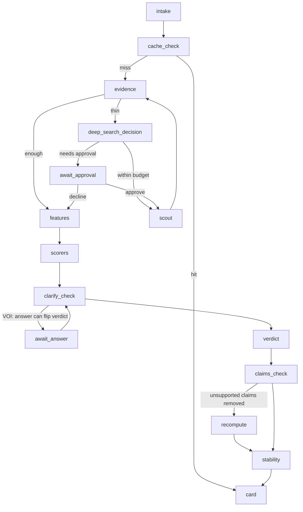

# orchestrator (M3): Orchestrator

Part of the Idea Validator system (docs/harness/03_ARCHITECTURE.md). One container per module.
This PR implements the **Validate** workflow. Discover, challenge and what-if sub-flows come later.

| | |
|---|---|
| Module | M3 |
| Port | 8000 |
| Probes | `GET /health`, `GET /ready` (Redis), `GET /metrics` |

## Endpoints (internal, `X-Internal-Token` required)
| Method and path | Body | Response |
|---|---|---|
| `POST /runs` | `{kind:"validate", user_id, input:{idea_text, idea_id, version, title?, overrides?, unknowns?}}` | 202 `{run_id}` |
| `GET /runs/{id}` | | `{run_id, kind, state, progress, spent, budget, pending_question, pending_approval, result, error}` |
| `POST /runs/{id}/answer` | `{question_id, answer}` (number) | 202; 409 if not the open question |
| `POST /runs/{id}/approve` | `{approval_id, decision: "approve"\|"decline"}` | 202; 409 if not the open approval |

States: `created, running, awaiting_input, awaiting_approval, succeeded, failed, budget_stopped`.
An unanswered question expires (default 600 s) and the run continues with the scorer's estimate; an
unanswered approval expires as declined (`approval_timeout_s`).

## Environment
`INTERNAL_TOKEN`, `REDIS_URL` (budget ledger `budget:{run_id}`, events on `run:{run_id}`),
`DATABASE_URL` (LangGraph Postgres checkpointer, schema `orchestrator`; without it checkpoints are in
memory and runs do not survive a restart), `CONFIG_DIR` (mounted `budgets.yaml`),
`QUESTION_TIMEOUT_S`, `PROFILE_URL`, `KB_URL`, `ANALYST_URL`, `SCOUTS_URL`, `VALIDATORS_URL`,
`VERDICT_URL`, `CRITIC_URL`.

## Graph

Any node routes to `card` when the run failed or hit its budget (partial result). `await_*` nodes
use LangGraph `interrupt()`.

## Rules the code enforces
- The verdict is whatever M11 `POST /verdict` returns; the orchestrator never computes, adjusts or rounds it.
- Scores without valid evidence ids abstain; unsupported claims (M12) are removed and M11 recomputes.
- Every module call goes through `StepRunner`: budget check, timeout, memoisation by step and input hash,
  trace span, events. Retries (max 2, timeouts/429/502/503/504 only) come from `common.http.ServiceClient`.
- Degraded results (a non-critical step failed, an unanswered question) are never cached.
- The card shows a verdict only when it is final: M11's answer after the claim check settled (either no
  claim was removed, or M11 recomputed after removals). If M12 `/check` fails, the budget stops the run
  between verdict and check, or the recompute fails, the card has `verdict: null`, `partial: true` and no
  `verdict` event is emitted.
- Effort is never invented. M11 requires `estimated_effort_hours`; when the scorers give no usable
  estimate the run asks a required question (counts toward the cap of 3, range 0..10000). If it is
  unanswered (or the cap is used up) M11 is not called: the run finishes with `verdict: null`,
  `partial: true`, `missing` and `needs_input: ["estimated_effort_hours"]` (run state `succeeded`, but a
  `partial` card never has a verdict; see docs/harness/05 for how clients must render it).
- User numbers are range-checked before they reach M11: effort 0..10000, hours_per_week 0..80,
  weeks_available 1..52, team_size 1..10 (finite, not bool). Overrides cover only those four fields;
  `n_sources`/`n_platforms` come from evidence and scores are never user-set (what-if goes through M11
  `/whatif`, out of scope here). Out-of-range answers return 422 and the run keeps waiting.
- M11 must answer for the run's idea_id and version, otherwise the run fails. A cached card with `partial` or
  `degraded` set is never served. A `versions` mismatch (mid-run rollout) shows the verdict but does not cache it.
- A cached card is served, and a fresh card stored, only if its `idea_id`, `version` and `versions`
  (engine, rubrics, profile_weights) equal the key's. A profile without a version fails the run.
- Cache key: `verdict:{idea_id}:{version}:{idea_hash}:p{profile}:r{rubrics}:w{weights}:e{engine}`.

## Spec deviations and known limits (stated openly)
- No M12 `/rail/input` call at intake and no M8 `/skeptic` call, so `objections_accepted` is always empty and the
  -0.5 challenge penalty cannot apply yet. The challenge step only checks score claims through M12 `/check`.
- Stability is only traced (from M11's `sensitivity` / `what_would_make_go`); there is no M11 `/whatif` call here.
- Approval is requested only for deep search (scouting), not for other steps that could pass the budget.
- CLARIFY runs after the scorers (it needs their effort estimate for the value-of-information call).
- `concurrency.scorers` is parsed into `RunConfig.scorer_concurrency` but unused: M9 runs the four scorers.
- Runs are not rehydrated after a restart: LangGraph checkpoints survive in Postgres but `RunService` forgets
  the in-memory run until rehydration from the M2 run mirror is built.
- Without `DATABASE_URL` the checkpointer is in memory; with `ENVIRONMENT=production` startup fails instead.
- M3 never compares `user_id`: M1 is the only caller and must enforce run ownership.
- Trace inputs are an `input_hash` only (no idea text or profile, per docs/harness/13 §8). Outputs, such as
  evidence and the verdict, are still traced.
- The verdict cache key has no `user_id`. This is safe because idea ids are globally unique (M2 guarantees it).
- `RunStatus` is not registered in LangGraph's msgpack allow-list; it round-trips through the default serializer today (tested with Postgres) but a stricter serializer setting would need it registered.
- Cache key versions cover M11, the profile and the idea only (scorer/critic versions are not exposed yet).
- Step budget: `StepRunner` reserves each step with `BudgetLedger.reserve` (one atomic Lua check-and-charge), so
  parallel fan-outs cannot overshoot `max_steps` (40 parallel reservations against a limit of 10 admit exactly 10).
  M3 charges only steps; pages, tokens and cost are charged by M5 into the same hash.

## Layout and tests
`api/` routes only, `services/` logic (no FastAPI imports), `repositories/` Redis and Postgres,
`clients/` typed clients, `testing.py` fakes (`FakeWorld`, `Harness`).
```bash
uv run pytest services/orchestrator -m "not integration"
TEST_REDIS_URL=redis://... TEST_DATABASE_URL=postgresql://... uv run pytest services/orchestrator
```
