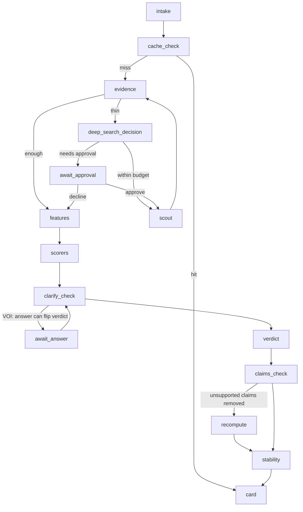

# orchestrator (M3): Orchestrator

Part of the Idea Validator system (docs/harness/03_ARCHITECTURE.md). One container per module.
This PR implements the **Validate** workflow. Discover, challenge and what-if sub-flows come later.

| | |
|---|---|
| Module | M3 |
| Port | 8000 |
| Probes | `GET /health`, `GET /ready` (Redis), `GET /metrics` |

## Endpoints (internal, `X-Internal-Token` required)
| Method and path | Body | Response |
|---|---|---|
| `POST /runs` | `{kind:"validate", user_id, input:{idea_text, idea_id, version, title?, overrides?, unknowns?}}` | 202 `{run_id}` |
| `GET /runs/{id}` | | `{run_id, kind, state, progress, spent, budget, pending_question, pending_approval, result, error}` |
| `POST /runs/{id}/answer` | `{question_id, answer}` (number) | 202; 409 if not the open question |
| `POST /runs/{id}/approve` | `{approval_id, decision: "approve"\|"decline"}` | 202; 409 if not the open approval |

States: `created, running, awaiting_input, awaiting_approval, succeeded, failed, budget_stopped`.
An unanswered question expires (default 600 s) and the run continues with the scorer's estimate; an
unanswered approval expires as declined (`approval_timeout_s`).

## Environment
`INTERNAL_TOKEN`, `REDIS_URL` (budget ledger `budget:{run_id}`, events on `run:{run_id}`),
`DATABASE_URL` (LangGraph Postgres checkpointer, schema `orchestrator`; without it checkpoints are in
memory and runs do not survive a restart), `CONFIG_DIR` (mounted `budgets.yaml`),
`QUESTION_TIMEOUT_S`, `PROFILE_URL`, `KB_URL`, `ANALYST_URL`, `SCOUTS_URL`, `VALIDATORS_URL`,
`VERDICT_URL`, `CRITIC_URL`.

## Graph

Any node routes to `card` when the run failed or hit its budget (partial result). `await_*` nodes
use LangGraph `interrupt()`.

## Rules the code enforces
- The verdict is whatever M11 `POST /verdict` returns; the orchestrator never computes, adjusts or rounds it.
- Scores without valid evidence ids abstain; unsupported claims (M12) are removed and M11 recomputes.
- Every module call goes through `StepRunner`: budget check, timeout, memoisation by step and input hash,
  trace span, events. Retries (max 2, timeouts/429/502/503/504 only) come from `common.http.ServiceClient`.
- Degraded results (a non-critical step failed, unknown effort, unanswered question) are never cached.
- Cache key: `verdict:{idea_id}:{version}:{idea_hash}:p{profile}:r{rubrics}:w{weights}:e{engine}`.

## Layout and tests
`api/` routes only, `services/` logic (no FastAPI imports), `repositories/` Redis and Postgres,
`clients/` typed clients, `testing.py` fakes (`FakeWorld`, `Harness`).
```bash
uv run pytest services/orchestrator -m "not integration"
TEST_REDIS_URL=redis://... TEST_DATABASE_URL=postgresql://... uv run pytest services/orchestrator
```
