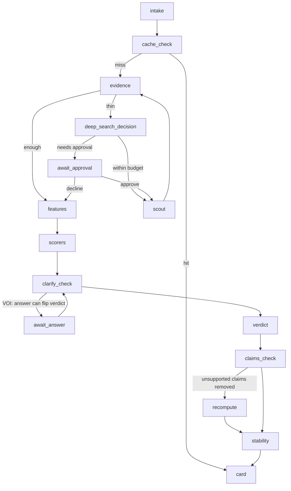
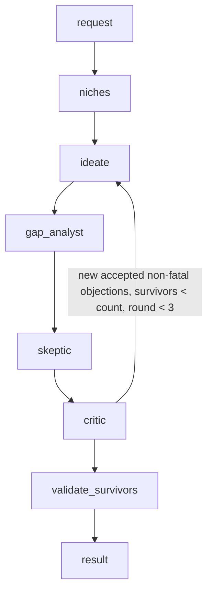

# orchestrator (M3): Orchestrator

Part of the Idea Validator system (docs/harness/03_ARCHITECTURE.md). One container per module.
This PR implements the **Validate** workflow. Discover, challenge and what-if sub-flows come later.

| | |
|---|---|
| Module | M3 |
| Port | 8000 |
| Probes | `GET /health`, `GET /ready` (Redis), `GET /metrics` |

## Endpoints (internal, `X-Internal-Token` required)
| Method and path | Body | Response |
|---|---|---|
| `POST /runs` | `{kind:"validate", user_id, input:{idea_text, idea_id, version, title?, overrides?, unknowns?}}` | 202 `{run_id}` |
| `GET /runs/{id}` | | `{run_id, kind, state, progress, spent, budget, pending_question, pending_approval, result, error}` |
| `GET /runs/{id}/events?after=<seq>` | | `{events:[RunEvent,...]}` stored events with `seq` > `after` (default 0), oldest first; unknown run: empty |
| `POST /runs/{id}/answer` | `{question_id, answer}` (number) | 202; 409 if not the open question |
| `POST /runs/{id}/approve` | `{approval_id, decision: "approve"\|"decline"}` | 202; 409 if not the open approval |

States: `created, running, awaiting_input, awaiting_approval, succeeded, failed, budget_stopped`.
An unanswered question expires (default 600 s) and the run continues with the scorer's estimate; an
unanswered approval expires as declined (`approval_timeout_s`).

## Environment
`INTERNAL_TOKEN`, `REDIS_URL` (budget ledger `budget:{run_id}`, events on `run:{run_id}`),
`DATABASE_URL` (LangGraph Postgres checkpointer, schema `orchestrator`; without it checkpoints are in
memory and runs do not survive a restart), `CONFIG_DIR` (mounted `budgets.yaml`),
`QUESTION_TIMEOUT_S`, `PROFILE_URL`, `KB_URL`, `ANALYST_URL`, `SCOUTS_URL`, `VALIDATORS_URL`,
`VERDICT_URL`, `CRITIC_URL`.
Recovery: `LEASE_TTL_S` (60), `RESUME_CONCURRENCY` (4), `RECOVERY_INTERVAL_S` (30; 0 = one pass at startup),
`RECOVERY_ATTEMPTS` (5), `RECOVERY_ATTEMPT_LIMIT` (3), `FINISHED_TTL_S` (86400).

## Surviving a restart
Runs are not lost when the pod restarts (docs/harness/07 §1). `RunService.recover()` runs in the
background at startup (`services/recovery.py`):

1. It pages through M2 `GET /internal/runs?state=created,running,awaiting_input,awaiting_approval`
   (the run mirror M3 writes after every transition; `context` holds `step`, `spent`, `pending_approval`,
   `result`, `error`).
2. For each run it takes a Redis lease (`run:{id}:lease`, TTL `LEASE_TTL_S`, renewed every third of the TTL
   while the run is active, released when it ends or on graceful shutdown). A run whose lease another
   replica holds is skipped, so two replicas recovering at once resume each run exactly once.
3. It reads the LangGraph checkpoint (`thread_id = run_id`):
   - a pending `interrupt()` becomes `awaiting_input` / `awaiting_approval` again with the same question or
     approval, so `answer` / `approve` work after the restart (the expiry timer restarts with its full timeout);
   - unfinished work (`next` nodes) is resumed once with `ainvoke(None)`, at most `RESUME_CONCURRENCY` at a time;
   - a graph that had finished is settled and the mirror corrected;
   - a missing, unreadable or foreign checkpoint (another run's `run_id`), or an unknown run kind, fails the
     run with the fixed text `the run could not be recovered after a restart` (never an exception text).
4. Budget: the Redis ledger is kept; if Redis lost it, the spend last mirrored to M2 is put back (never over an
   existing ledger). A step that was in flight is claimed in Redis before it is charged and released when it
   finishes or fails; a claim left by a dead process means the re-run is not charged again (steps that
   completed are memoised in the checkpoint and cost nothing).
5. Events are stored in a bounded Redis list (`run:{id}:events`, 2000 entries, 7 days) before they are
   published; the emitter continues after the last stored `seq`, and `GET /runs/{id}/events` replays them.

Hardening (docs/harness/13):
- **Poison runs.** Every restore counts in Redis (`run:{id}:recoveries`); past `RECOVERY_ATTEMPT_LIMIT` (3) the run
  is failed with the fixed reason. The count resets once the run is safely paused or finished. A step claimed
  by a dead process may be re-run free at most twice (`MAX_STEP_RERUNS`); then it stops the run as
  `budget_stopped` (`exceeded: ["reruns"]`). A step is free only after it was charged (`mark_paid`), so a
  crash between claim and charge never leaves an unbilled step.
- **Checkpoint trust.** A restored state is validated again from its plain data (LangGraph falls back to an
  unvalidated `model_construct` when it cannot read one), its `run_id` and `user_id` must equal the mirror's,
  and a graph with nothing left to run must be terminal (and hold a card for validate/what-if) or the run is
  failed, never shown as `succeeded` with no result.
- **No split brain.** A pause is mirrored to M2 before its expiry timer starts; any error while restoring
  cancels that run's task and timer and frees its lease.
- **Leases.** The heartbeat abandons a run after `lease_failures_allowed` (2) consecutive failed renewals, before
  the TTL lets another replica take it, and the loop survives any error inside a pass.
- **Budget mirror.** Spend and the approved cost raise (`cost_bonus_usd`) are restored atomically (only into a
  missing hash). A mirror with unreadable spend fails the run instead of giving it a fresh budget. The
  mirror leaves `result` out (`result_truncated`) when its context passes 60 KB; M2 caps `input`, `context` and
  `pending_question` at 64 KB each.
- **Events.** `run:{id}:seq` holds the last sequence number, so it continues even if the list is lost, and a poll
  reads only the tail of the list (nothing when there is nothing new).
- **Memory.** Finished runs leave memory `FINISHED_TTL_S` (24 h) after they end; M2 keeps the record.
- **Logs.** A crashed run logs the exception type and the file:line only, never its message or a traceback
  (they can quote the idea text).
- **Access control.** `GET /runs/{id}/events` does not check ownership (M3 never compares `user_id`): the gateway
  must confirm the run belongs to the caller through M2 before it proxies events or any other run call. M2's
  `/internal/*` is reachable only by the gateway and the orchestrator (the NetworkPolicy edges
  `gateway -> profile` and `orchestrator -> profile` in scripts/gen_k8s.py, unchanged) and needs the internal token.

The loop sweeps again every `RECOVERY_INTERVAL_S`, which adopts the runs of a crashed replica once its leases
lapse (at most `LEASE_TTL_S` later). While M2 is down a pass is retried with a doubling delay.

## Graph

Any node routes to `card` when the run failed or hit its budget (partial result). `await_*` nodes
use LangGraph `interrupt()`.

## Rules the code enforces
- The verdict is whatever M11 `POST /verdict` returns; the orchestrator never computes, adjusts or rounds it.
- Scores without valid evidence ids abstain; unsupported claims (M12) are removed and M11 recomputes.
- Every module call goes through `StepRunner`: budget check, timeout, memoisation by step and input hash,
  trace span, events. Retries (max 2, timeouts/429/502/503/504 only) come from `common.http.ServiceClient`.
- Degraded results (a non-critical step failed, an unanswered question) are never cached.
- The card shows a verdict only when it is final: M11's answer after the claim check settled (either no
  claim was removed, or M11 recomputed after removals). If M12 `/check` fails, the budget stops the run
  between verdict and check, or the recompute fails, the card has `verdict: null`, `partial: true` and no
  `verdict` event is emitted.
- Effort is never invented. M11 requires `estimated_effort_hours`; when the scorers give no usable
  estimate the run asks a required question (counts toward the cap of 3, range 0..10000). If it is
  unanswered (or the cap is used up) M11 is not called: the run finishes with `verdict: null`,
  `partial: true`, `missing` and `needs_input: ["estimated_effort_hours"]` (run state `succeeded`, but a
  `partial` card never has a verdict; see docs/harness/05 for how clients must render it).
- User numbers are range-checked before they reach M11: effort 0..10000, hours_per_week 0..80,
  weeks_available 1..52, team_size 1..10 (finite, not bool). Overrides cover only those four fields;
  `n_sources`/`n_platforms` come from evidence and scores are never user-set (what-if goes through M11
  `/whatif`, out of scope here). Out-of-range answers return 422 and the run keeps waiting.
- M11 must answer for the run's idea_id and version, otherwise the run fails. A cached card with `partial` or
  `degraded` set is never served. A `versions` mismatch (mid-run rollout) shows the verdict but does not cache it.
- A cached card is served, and a fresh card stored, only if its `idea_id`, `version` and `versions`
  (engine, rubrics, profile_weights) equal the key's. A profile without a version fails the run.
- Cache key: `verdict:{idea_id}:{version}:{idea_hash}:p{profile}:r{rubrics}:w{weights}:e{engine}`.

## Spec deviations and known limits (stated openly)
- No M12 `/rail/input` call at intake. The Validate skeptic step is implemented but needs a structured (M8) idea in the
  run state, which no endpoint passes yet; Discover applies objections during its debate instead. A free-text validate
  therefore still sends an empty `objections_accepted`.
- The M2 idea/version endpoints (`GET .../versions/{v}`, `POST .../versions`) are assumed shapes; M2 has not built them yet.
- Discover's `deep_search` flag is accepted but children never scout (unattended runs cannot be asked for approval).
- Discover ideas are not saved to M2 (`POST /internal/ideas`), only returned in the result.
- Stability is only traced (from M11's `sensitivity` / `what_would_make_go`); there is no M11 `/whatif` call here.
- Approval is requested only for deep search (scouting), not for other steps that could pass the budget.
- CLARIFY runs after the scorers (it needs their effort estimate for the value-of-information call).
- `concurrency.scorers` is parsed into `RunConfig.scorer_concurrency` but unused: M9 runs the four scorers.
- Recovery limits: a question or approval gets its full timeout again after a restart; a step cut off by a
  crash is re-run from its start (steps are idempotent only through the memo, so an external side effect such
  as a scout could repeat); Discover children that were in flight are re-run with their parent node; events
  live in Redis, so a Redis without persistence loses replay (the SSE stream then falls back to live-only).
- M3 writes the run mirror in M2's shape (`state`, `input`, `context`, `pending_question`); the gateway's
  own start-time write of `input` is overwritten by M3's copy of the validated request.
- Without `DATABASE_URL` the checkpointer is in memory; with `ENVIRONMENT=production` startup fails instead.
- M3 never compares `user_id`: M1 is the only caller and must enforce run ownership.
- Trace inputs are an `input_hash` only (no idea text or profile, per docs/harness/13 §8). Outputs, such as
  evidence and the verdict, are still traced.
- The verdict cache key has no `user_id`. This is safe because idea ids are globally unique (M2 guarantees it).
- Checkpoints are read through a strict msgpack allow-list (`repositories/serde.py`: `RunStatus` and the three state
  models). A new state model or enum must be added there; a test fails if one is missing.
- Cache key versions cover M11, the profile and the idea only (scorer/critic versions are not exposed yet).
- Step budget: `StepRunner` reserves each step with `BudgetLedger.reserve` (one atomic Lua check-and-charge), so
  parallel fan-outs cannot overshoot `max_steps` (40 parallel reservations against a limit of 10 admit exactly 10).
  M3 charges only steps; pages, tokens and cost are charged by M5 into the same hash.

## Discover, challenge and what-if (kinds of `POST /runs`)
Bodies are validated strictly (see docs/harness/05 §3); ids are `[A-Za-z0-9_-]{1,64}`.

- **Discover**: M7 niches and gaps, then at most 3 debate rounds (hard cap in code and config; a configured value above 3 is a
  startup error). Each round: M8 `/ideate` (count + 3), `/gap-analyst`, `/skeptic`, M12 `/objections/filter`. Drop rules: one
  accepted fatal objection, two accepted objections on different dimensions, or no gap evidence (`idea_dropped` event with reason,
  round and the evidence ids). The loop stops early with no new accepted non-fatal objections or enough survivors (A-20).
  Survivors (fewest objections first, at most `count`) go through the Validate graph, 3 at a time, sharing the run budget, with
  their accepted objections as M11 `objections_accepted`. They run unattended (no questions, no approvals): the effort comes from the
  ideator's scope (S 60 / M 160 / L 400 h, the same table M8 uses). Ranking is plain code: verdict rank, then score, then
  confidence (A-19); it never changes a verdict. `partial_result` events stream as children finish.
- **Challenge**: M2 gives the stored card; M12 `/check` re-checks the claim. Supported means `defended`. Otherwise `removed`: M2
  creates a new version (`challenge removed <claim>`), the claim's dimension abstains in the recorded M11 input and M11 recomputes.
  If M11 fails after M2 created the version, the version exists without a card (the run fails).
- **What-if**: M2 gives the base text and card, M8 `/rewrite` applies the chosen (or custom) change, M2 saves the new version, then the
  Validate graph rescores it. Step outputs of the previous run of the same idea are reused when their input hash is unchanged
  (in memory, lost on restart).
- **Skeptic in Validate** (step 6): runs when the run state holds a structured idea (an M8 idea; no endpoint passes one yet): M8 `/skeptic`, M12 `/objections/filter`,
  then M11 recomputes with the accepted objections. A free-text idea has no structure for M8, so the step is skipped for it.

## Layout and tests
`api/` routes only, `services/` logic (no FastAPI imports), `repositories/` Redis and Postgres,
`clients/` typed clients, `testing.py` fakes (`FakeWorld`, `Harness`).
```bash
uv run pytest services/orchestrator -m "not integration"
TEST_REDIS_URL=redis://... TEST_DATABASE_URL=postgresql://... uv run pytest services/orchestrator
```
